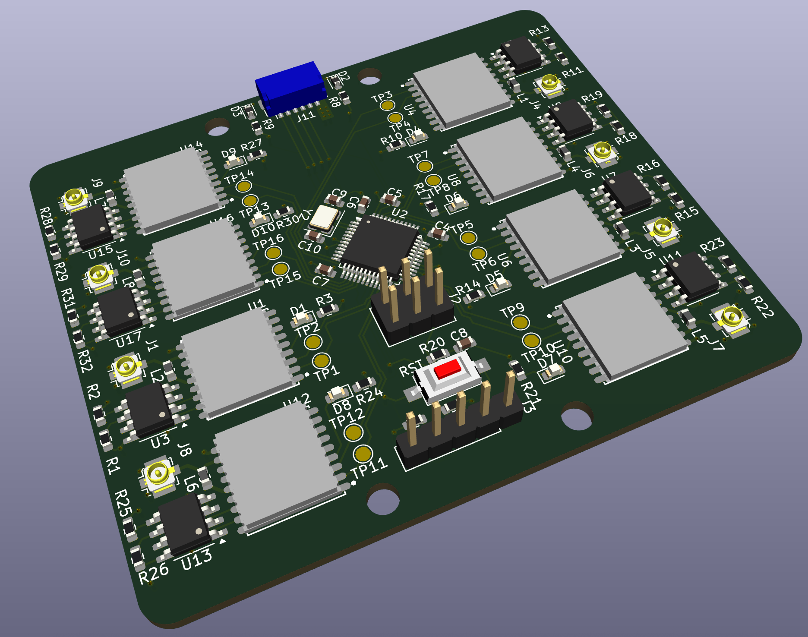
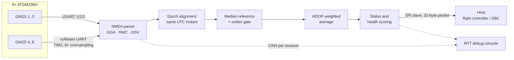
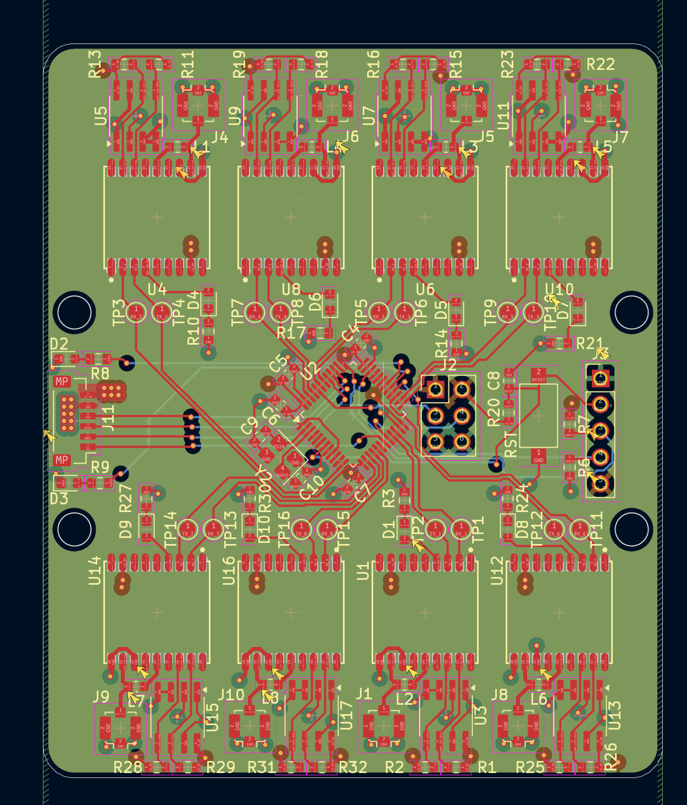
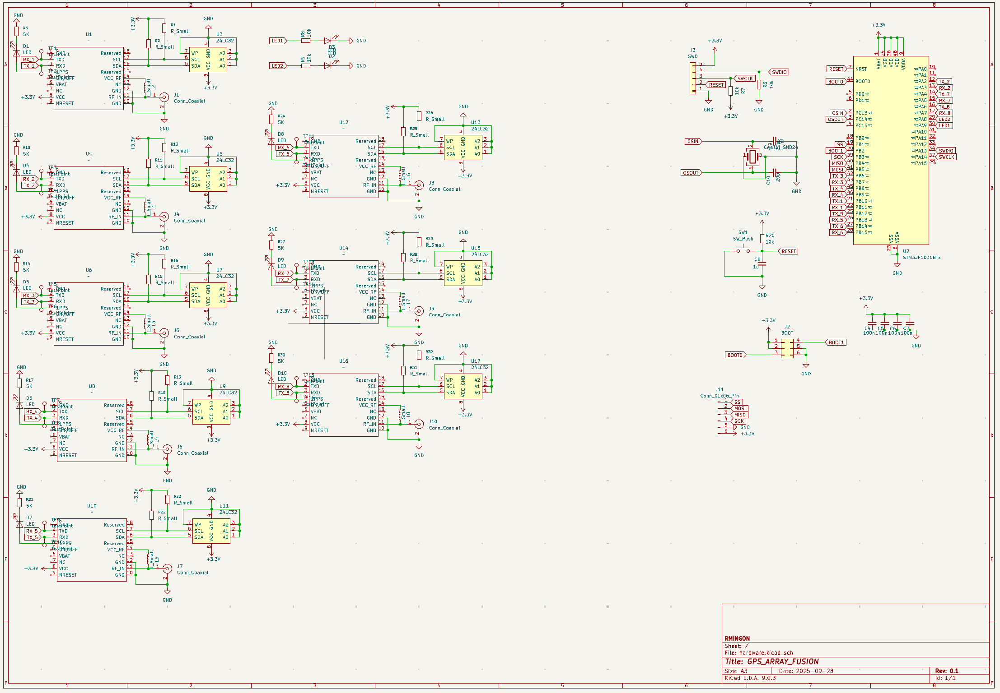
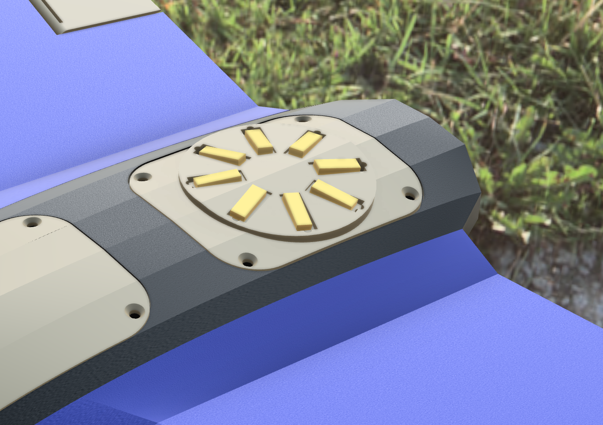

<h1 align="center">EchoGuard-8</h1>

<p align="center">
  <b>Eight GNSS receivers. One board. One trusted position.</b><br>
  An open hardware GNSS fusion array built around 8× ATGM336H receivers and an STM32F103,<br>
  with real-time outlier rejection and a single fused solution over SPI.
</p>

<p align="center">
  
  
  
  
  
  
</p>

<p align="center">
  
</p>

<p align="center">
  <a href="#why-an-array">Why an array</a> ·
  <a href="#how-it-works">How it works</a> ·
  <a href="#hardware">Hardware</a> ·
  <a href="#spi-interface">SPI interface</a> ·
  <a href="#arduino-library">Arduino library</a> ·
  <a href="#getting-started">Getting started</a> ·
  <a href="#roadmap">Roadmap</a>
</p>

---

## Why an array?

A single GNSS receiver gives you a position and asks you to trust it. When it suffers from
multipath, a weak antenna or a glitch, nothing tells you.

EchoGuard-8 runs **eight independent receivers side by side** and cross-checks them on every
GNSS epoch. That gives a host system three things a single receiver cannot:

| | |
| --- | --- |
| **Redundancy** | Any receiver can drop out. The fused solution keeps going with the others. |
| **Self-checking** | A receiver that drifts away from the consensus is detected, rejected, and benched if it keeps misbehaving. |
| **A trust signal** | Every output carries a status (`OK`, `DEGRADED`, `INTERFERENCE`, `NO_FIX`), the number of receivers used and their spread, so the host knows how much to rely on GNSS. |

Averaging also reduces the noise that is independent between receivers. Errors shared by all
of them (atmosphere, a jammer hitting every antenna) are not removed by averaging: for those,
the value of the array is in **detecting** the problem and telling the host.

## Highlights

- **8× ATGM336H** multi-constellation receivers, each with its own U.FL antenna input
- **STM32F103C8** running FreeRTOS: 3 hardware UARTs plus 5 timer-driven software UARTs
- **Epoch-aligned fusion**: only positions measured at the same GNSS instant are combined
- **Robust estimator**: median reference, HDOP-scaled outlier gate, inverse-variance weighting
- **Per-receiver health tracking** with automatic exclusion of faulty modules
- **C/N0 signal monitoring** on every receiver for interference diagnosis
- **32-byte CRC-protected SPI packet** for easy integration with a flight controller or SBC
- **Arduino library** with ready-to-run examples
- **4-layer PCB** with dedicated ground and power planes and per-module supply filtering
- **Live debug over SEGGER RTT**, no extra UART needed

## How it works



The fusion runs at 5 Hz and proceeds in five steps:

1. **Candidate selection.** A receiver is considered only if it has a valid fix, reported a
   position in the last 2 s, and is not currently benched by its fault score.
2. **Epoch alignment.** Fixes are grouped by the UTC time in their NMEA sentence (50 ms
   tolerance). The epoch reported by the most receivers wins, so positions measured at
   different instants are never mixed. A receiver that is one epoch late is skipped, not
   penalised.
3. **Outlier rejection.** The median latitude and longitude form a robust reference. A
   receiver is rejected when its horizontal distance to that reference exceeds
   `20 m + 15 m × HDOP` (clamped to 25..150 m).
4. **Weighted average.** The remaining receivers are combined with a weight of `1 / HDOP²`.
   Offsets are averaged around the median rather than absolute coordinates, which keeps
   single-precision floats exact to the centimetre.
5. **Status and health.** Each receiver carries a fault score that rises when it is rejected
   and decays when it agrees with the others. Above the limit, it is excluded from the
   solution. The result is then labelled:

| Status | Value | Meaning |
| --- | :---: | --- |
| `NO_FIX` | 0 | No usable receiver |
| `OK` | 1 | At least 4 receivers agree within 30 m, at most 1 rejected, average HDOP below 2.5 |
| `DEGRADED` | 2 | A solution exists but with reduced confidence |
| `INTERFERENCE` | 3 | 2 or more receivers rejected, spread above 80 m, or average HDOP above 5 |

### Signal monitoring

The firmware decodes the GSV sentences of every receiver and tracks its carrier-to-noise
density (C/N0) per constellation. The debug console prints, once per second, each receiver's
state and one summary line for the whole array:

```text
[gnss #3 U6 ] alive nmea=812 err=0 fix q=1 sats=9 hdop=0.95 lat=+48.8583000 lon=+2.2945000 cn0 top4=44.7 avg=40.2 max=47 trk=9/14 gps=6/9 bds=3/5
[cn0 array] modules=8 top4=43.9 min=41.2 (#5) max=45.8 (#2)
[fusion OK used=8 rej=0 hdop=98 res=142cm] lat=+48.8583012 lon=+2.2945004 alt=62.40m utc=12:35:19.000
```

`top4` is the mean of the four strongest satellites, a figure that barely depends on sky
geometry. If it drops on every receiver at once, interference is reaching all antennas. If it
is low on one receiver only, the cause is local: antenna, cable or routing.

## Hardware

| PCB layout | Schematic |
| :---: | :---: |
|  |  |

| | |
| --- | --- |
| **Receivers** | 8× ATGM336H, one U.FL antenna connector each |
| **MCU** | STM32F103C8T6 (Cortex-M3, 64 KB flash, 20 KB RAM) |
| **Stack-up** | 4 layers: signal / GND / +3.3 V / signal |
| **Supply** | Single regulated 3.3 V input, LC filter on every receiver |
| **Host link** | SPI slave on a 6-pin JST-SH connector (`J11`) |
| **Debug** | SWD header, reset and boot controls, one test point pair and one LED per receiver |
| **Storage** | One 24LC32 EEPROM on each receiver's I²C port |
| **Design tool** | KiCad |

### RF design choices

- A continuous ground plane directly under the top layer gives every RF trace a clean return path.
- Each receiver has its own filtered supply branch, so one module cannot inject noise into its neighbours.
- The MCU, the crystal and the SPI lines sit in the centre of the board, away from the antenna inputs on the edges.
- Antennas are remote (U.FL), so they can be placed where the sky view is best and away from noisy electronics.

### Receiver pin map

| Receiver | Reference | MCU RX pin | Link |
| :---: | :---: | :---: | --- |
| 1 | U1 | PB11 | USART3 |
| 2 | U4 | PA3 | USART2 |
| 3 | U6 | PB7 | USART1 (remapped) |
| 4 | U8 | PB9 | Software UART |
| 5 | U10 | PB13 | Software UART |
| 6 | U12 | PB15 | Software UART |
| 7 | U14 | PA5 | Software UART |
| 8 | U16 | PA7 | Software UART |

All receivers run at 9600 baud. The complete pin list is in [software/README.md](./software/README.md).

### ATGM336H at a glance

| Parameter | Value |
| --- | --- |
| Constellations | GPS, BeiDou, GLONASS, QZSS, SBAS |
| Positioning accuracy | ~2.5 m CEP |
| Cold start | < 35 s |
| Hot start | < 1 s |
| Update rate | Up to 10 Hz |
| Interface | UART (NMEA 0183) |
| Tracking current | ~26 mA |
| Operating temperature | -40 °C to +85 °C |

The full datasheet is included: [002176_ATGM336H.pdf](./002176_ATGM336H.pdf).

## SPI interface

EchoGuard-8 is an **SPI slave** (mode 0, MSB first). Each time the host asserts `SS`, the
board streams one 32-byte little-endian packet on `MISO`.

**Connector `J11` (JST-SH, 6 pins)**

| Pin | 1 | 2 | 3 | 4 | 5 | 6 |
| --- | :---: | :---: | :---: | :---: | :---: | :---: |
| Signal | `SS` (active low) | `MOSI` | `MISO` | `SCK` | `GND` | `+3.3V` |

**Packet layout**

| Offset | Type | Field | Description |
| :---: | :---: | --- | --- |
| 0 | `u32` | `magic` | `0x31464745`, ASCII `EGF1` |
| 4 | `u32` | `tick_ms` | Board uptime at the last fusion update |
| 8 | `i32` | `lat_e7` | Latitude, degrees × 10⁷ |
| 12 | `i32` | `lon_e7` | Longitude, degrees × 10⁷ |
| 16 | `i32` | `alt_cm` | Altitude, centimetres |
| 20 | `u16` | `avg_hdop_centi` | Average HDOP of the receivers used, × 100 |
| 22 | `u16` | `max_residual_cm` | Largest distance between a used receiver and the median, centimetres |
| 24 | `u8` | `status` | Fusion status, see the table above |
| 25 | `u8` | `used_modules` | Receivers used in this solution |
| 26 | `u8` | `rejected_modules` | Receivers rejected as outliers |
| 27 | `u8` | `has_fix` | 1 when the position is valid |
| 28 | `u16` | reserved | Zero |
| 30 | `u16` | `crc16` | CRC-16/CCITT-FALSE over bytes 0..29 |

**Timing**

The board builds the packet when `SS` falls and answers from an interrupt handler. Wait about
500 µs between asserting `SS` and the first clock edge, and start with a 100 kHz clock. The
solution is refreshed 5 times per second.

**Reading it from a Raspberry Pi**

`SS` is driven by hand here, because the Linux SPI driver gives no delay between chip select
and the first clock edge.

```python
import binascii
import struct
import time

import spidev
from gpiozero import DigitalOutputDevice

ss = DigitalOutputDevice(25, active_high=False, initial_value=False)  # SS on GPIO 25

spi = spidev.SpiDev()
spi.open(0, 0)
spi.no_cs = True
spi.mode = 0
spi.max_speed_hz = 100_000

ss.on()             # assert SS (drives the line low)
time.sleep(0.0005)  # let the board build the packet
packet = bytes(spi.xfer2([0] * 32))
ss.off()

(magic, tick_ms, lat_e7, lon_e7, alt_cm, hdop_centi, residual_cm,
 status, used, rejected, has_fix, crc) = struct.unpack("<IIiiiHHBBBB2xH", packet)

if magic == 0x31464745 and crc == binascii.crc_hqx(packet[:30], 0xFFFF) and has_fix:
    print(f"{lat_e7 / 1e7:.7f}, {lon_e7 / 1e7:.7f}  alt {alt_cm / 100:.2f} m  "
          f"status {status}  {used} receivers used, {rejected} rejected")
```

## Arduino library

The [`EchoGuard8`](https://github.com/rmingon/EchoGuard8-Library) library reads the fused
solution from any Arduino board and handles the SPI timing, the CRC check and the decoding
for you.

```cpp
#include <EchoGuard8.h>

EchoGuard8 gnss(10);  // chip select pin

void setup() {
  Serial.begin(115200);
  gnss.begin();
}

void loop() {
  EchoGuard8Fix fix;
  if (gnss.read(fix) && fix.hasFix) {
    EchoGuard8::printDegrees(Serial, fix.latitudeE7);
    Serial.print(", ");
    EchoGuard8::printDegrees(Serial, fix.longitudeE7);
    Serial.print("  ");
    Serial.println(EchoGuard8::statusName(fix.status));
  }
  delay(1000);
}
```

It ships with four examples: `BasicRead`, `TrustMonitor` (status changes, link supervision,
LED), `Geofence` (distance to a home position with an alarm) and `PacketDump` (wiring
diagnostic). Wiring, API reference and troubleshooting are in the
[library repository](https://github.com/rmingon/EchoGuard8-Library#readme).

The library has its own repository and is included here as a git submodule. To fetch it with
the project, clone with `git clone --recurse-submodules`.

## Getting started

**You need:** an assembled board, 8 GNSS antennas with U.FL connectors, a regulated 3.3 V
supply, a J-Link compatible SWD probe, and [PlatformIO](https://platformio.org/).

```bash
git clone https://github.com/rmingon/EchoGuard-8.git
cd EchoGuard-8/software

pio run                      # build
pio run -t upload            # flash over SWD
python3 tools/rtt_read.py    # live debug console (SEGGER RTT)
```

Then connect `J11` to your host and start reading packets. Give the receivers a clear view of
the sky: a cold start takes around half a minute before the first fix.

## Built for FalconEdge

EchoGuard-8 is the positioning module of [FalconEdge](https://github.com/rmingon/Falcon-Edge),
a fixed-wing drone project. The eight antennas sit in a radial pattern in a dedicated bay on
top of the airframe.

<p align="center">
  
</p>

## Project status

EchoGuard-8 is a prototype. The firmware builds and runs on the board; hardware bring-up and
field validation are in progress.

Known limitation of the current board revision: the external crystal does not start, so the
firmware runs from the internal oscillator (64 MHz through the PLL).

## Roadmap

- [ ] Use C/N0 as a fusion weight alongside HDOP
- [ ] Raise an interference flag when C/N0 drops on all receivers at once
- [ ] Route one PPS signal to the host connector for precise timestamping
- [ ] Add speed and course to the SPI packet
- [ ] Publish field results against a reference receiver

## Repository layout

```text
hardware/              KiCad project: schematic and PCB
software/              PlatformIO firmware (STM32Cube HAL + FreeRTOS)
  ├─ src/              GNSS drivers, NMEA parser, fusion, SPI output
  ├─ include/          Public headers
  └─ tools/            RTT debug reader
arduino/
  └─ EchoGuard8/       Arduino library for host boards (git submodule)
002176_ATGM336H.pdf    Receiver datasheet
licence.md             CERN-OHL-S v2 licence text
```

## Contributing

Issues and pull requests are welcome, whether for the hardware, the firmware or the
documentation. If you build a board, share your results: field data from other locations is
especially valuable.

## License

EchoGuard-8 is released under the **CERN Open Hardware Licence Version 2, Strongly
Reciprocal** (CERN-OHL-S v2). See [licence.md](./licence.md) for the full text.
